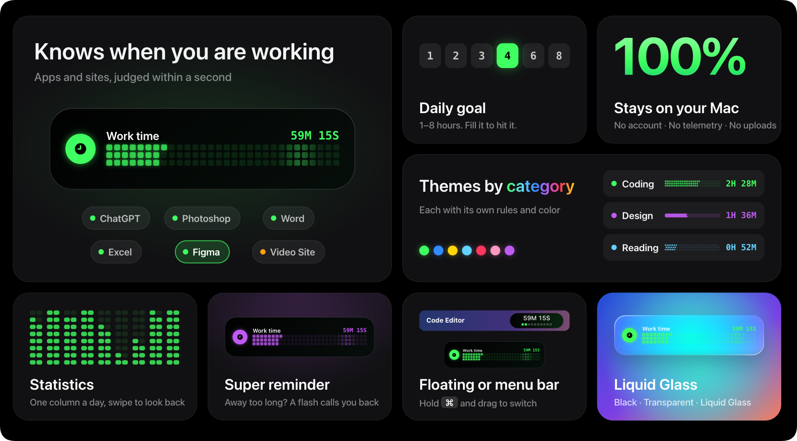

# Work Island

English · [简体中文](README.zh-CN.md)



A local work timer for macOS and Windows.
Track work time using app and optional website rules, and see your daily progress in a floating window or the menu bar / system tray.

## Trailer

https://github.com/user-attachments/assets/28697375-347d-45ac-888c-212086264d60

## About Work Island

After spending all day at my computer, I'd still wonder how much time went into meaningful work—coding, editing videos, or building something that lasts. That anxiety led me to make Work Island.

I set myself a daily goal of four hours of focused work. Each dot lights up as time accumulates, making the day's effort visible and easing the feeling that it was wasted.

Work Island uses the mouse's actual position to identify what you're focusing on. Moving away or staying inactive for too long switches it to an idle state. You can adjust the detection thresholds to suit your work.

I hope it helps independent developers, freelancers, and anyone who works at a screen see their effort and build a sense of progress each day.

## Download

[Installers and release notes](https://github.com/Yoturnfish/Work-Island/releases)

| Platform | Version | System | Package |
| --- | --- | --- | --- |
| macOS | 0.8.28 (87) | macOS 15+, Apple Silicon | DMG |
| Windows | 0.1.24 | Verified on Windows 11 x64 | Installer, portable ZIP |

On Mac, open the DMG and drag the app to Applications. On Windows, run the installer or extract the portable ZIP and launch the app.
The Mac package is signed with a local certificate and has not been notarized by Apple. The Windows packages are unsigned.

## Features

- Floating window and menu bar / system tray modes.
- App and optional website rules, with working, idle, and manually paused states.
- Daily goals, a configurable day boundary, history, and time corrections.
- Color combinations, progress styles, and English / Chinese interfaces.
- Black, transparent, and Liquid Glass backgrounds on Mac; native platform materials on Windows.

## Privacy and permissions

Data stays on your computer. There is no telemetry or online account service. The two platforms use separate data formats; cross-platform sync is not available.
The app reads the foreground or most recently interacted-with app's identifier and system input idle time. It does not record keystroke contents.
With website rules enabled, it reads URLs from supported browsers for matching. Full URLs are not stored in time history.

On Mac, website detection requires browser automation permission. Liquid Glass requires Screen Recording permission to render the material from the area behind the window; captured images are not saved or uploaded. The black and transparent themes do not capture the screen.

## Build from source

macOS requires Swift 6.1+ and a compatible Xcode version:

```sh
swift test
swift run FocusIsland
sh scripts/package_app.sh
```

Windows requires PowerShell 7 and .NET SDK 10.0.401 (later patches in the same feature band are allowed):

```powershell
cd windows
./build.ps1 -BuildId local
```

See the [Windows build and installation guide](windows/README.md), [architecture notes](docs/ARCHITECTURE.md), and [Mac offline tutorial](使用教程.html). These guides are currently in Chinese.

## Feedback and contributions

Report bugs or suggest improvements in [Issues](https://github.com/Yoturnfish/Work-Island/issues).
Read the [contribution guide](CONTRIBUTING.md) before submitting code, and the [security policy](SECURITY.md) for security reports.

MIT License · Yoturn. See [third-party notices](THIRD_PARTY_NOTICES.md) for dependencies and resources.
